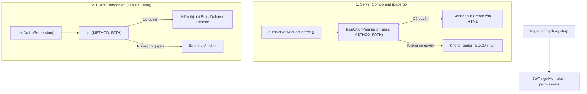

# Tài liệu kỹ thuật: Phân quyền ẩn/hiện nút hành động trên giao diện Admin (Action-Level RBAC)

> **Nhánh Use Case**: `uc-06.08-permission-action-visibility`  
> **Dự án**: Frevia (frevia-clone)  
> **Phạm vi**: Ứng dụng Web (`apps/web`), Cổng quản trị Admin (`/admin/*`)

---

## 1. Đặt vấn đề & Mục tiêu

### 1.1. Vấn đề
Trước đây trên các giao diện quản trị Admin (ví dụ: Danh mục Kỹ năng, Danh mục Công việc, Danh mục Diễn đàn), các nút hành động như **Thêm mới (Create)**, **Chỉnh sửa (Edit)**, **Xóa (Delete)**, **Khôi phục (Restore)** luôn hiển thị mặc định cho mọi người dùng có quyền truy cập vào trang.

Nếu một vai trò (Role) chỉ được cấp quyền xem (`GET`) và sửa (`PATCH`), nhưng **không** được cấp quyền tạo mới (`POST`), thì:
* Nút Tạo mới vẫn hiển thị trên màn hình.
* Khi người dùng nhấp vào nút Tạo và gửi form, Backend sẽ trả về lỗi `403 Forbidden`.
* Trải nghiệm người dùng (UX) bị giảm sút và giao diện gây hiểu lầm về quyền hạn thực tế của tài khoản.

### 1.2. Giải pháp (Best Practice từ các hệ thống lớn)
Áp dụng giải pháp **Ẩn hoàn toàn (Remove from DOM)** đối với các nút và hành động mà tài khoản không có quyền:
* **Server-side (SSR)**: Không sinh HTML của các nút hành động bị cấm ngay từ lúc render trên Server.
* **Client-side (SPA / React)**: Tự động ẩn các nút trong bảng dữ liệu hoặc dialog khi kiểm tra danh sách quyền của người dùng.
* **Nguyên tắc bảo vệ kép (Defense in Depth)**: Frontend ẩn nút để tối ưu UX, Backend tiếp tục giữ các Guard (`AuthGuard`, `PermissionGuard`) để bảo đảm an toàn dữ liệu tuyệt đối.

---

## 2. Kiến trúc giải pháp (Architecture & Design)



### 2.1. Hàm kiểm tra quyền dùng chung (`apps/web/lib/admin-access.ts`)
Hàm `hasActionPermission(userOrPermissions, method, path)` nhận vào đối tượng người dùng hoặc mảng permissions, cùng cặp `(METHOD, PATH)`.

**Đặc điểm nổi bật**:
1. **Wildcard & Admin bypass**: Tự động trả về `true` nếu người dùng có role `ADMIN` hoặc sở hữu quyền wildcard `*`.
2. **Chuẩn hóa đường dẫn**: Tự động xử lý tiền tố `/api`, xóa query params.
3. **So khớp tham số URL động (Route Parameters)**:
   * Pattern trong database: `PATCH /api/admin/skills/:id`
   * Đường dẫn thực tế gọi: `PATCH /api/admin/skills/15`
   * Hàm tự động khớp các segment bắt đầu bằng `:` với giá trị ID thực tế.

### 2.2. Hook & Component Client-side (`apps/web/hooks/use-action-permission.tsx`)
Cung cấp bộ công cụ trực quan cho lập trình viên phía Client:
* `can(method, path)`: Kiểm tra 1 hành động cụ thể.
* `canAny([{ method, path }, ...])`: Kiểm tra xem có ít nhất 1 quyền trong danh sách hay không.
* `canAll([{ method, path }, ...])`: Kiểm tra xem có đủ toàn bộ quyền hay không.
* `<Can method="..." path="...">...</Can>`: Component bọc JSX để ẩn/hiện điều kiện mà không cần viết lệnh rẽ nhánh phức tạp.
* Sử dụng `useMemo` và `useCallback` tránh re-render thừa.

---

## 3. Danh sách các màn hình đã triển khai

### 3.1. Quản lý Kỹ năng (Skills)
* **Route**: `/admin/skills` & `/admin/skills/[id]`
* **Các quyền áp dụng**:
  * `POST /api/admin/skills`: Ẩn/hiện nút **"Thêm kỹ năng"** trên thanh tiêu đề trang chính.
  * `PATCH /api/admin/skills/:id`: Ẩn/hiện nút **Sửa** trong từng dòng và trên trang chi tiết.
  * `DELETE /api/admin/skills/:id`: Ẩn/hiện nút **Xóa** trong từng dòng và trên trang chi tiết.
  * `PATCH /api/admin/skills/:id/restore`: Ẩn/hiện nút **Khôi phục** đối với các kỹ năng đã xóa mềm.
  * Nếu một kỹ năng không có quyền Sửa lẫn Xóa, ô Actions ở cuối dòng sẽ tự động ẩn sạch sẽ.

### 3.2. Quản lý Danh mục Công việc (Job Categories)
* **Route**: `/admin/job-categories` & `/admin/job-categories/[id]`
* **Các quyền áp dụng**:
  * `POST /api/admin/job-categories`: Ẩn/hiện nút **"Thêm danh mục"** trên thanh tiêu đề trang chính.
  * `PATCH /api/admin/job-categories/:id`: Ẩn/hiện nút **Sửa** (Dialog chỉnh sửa).
  * `DELETE /api/admin/job-categories/:id`: Ẩn/hiện nút **Xóa**.
  * `PATCH /api/admin/job-categories/:id/restore`: Ẩn/hiện nút **Khôi phục**.
  * Đồng bộ tự động trên trang chi tiết `/admin/job-categories/[id]`.

### 3.3. Quản lý Danh mục Diễn đàn (Forum Categories)
* **Route**: `/admin/categories` & `/admin/categories/[id]`
* **Các quyền áp dụng**:
  * `POST /api/forums/admin/categories`: Ẩn/hiện nút **"Tạo danh mục"** trên trang chính.
  * `GET /api/forums/admin/categories/:id`: Ẩn/hiện nút icon **Xem chi tiết**.
  * `PATCH /api/forums/admin/categories/:id`: Ẩn/hiện nút icon **Sửa** trên bảng và nút `EditCategoryButton` trên trang chi tiết.
  * `DELETE /api/forums/admin/categories/:id`: Ẩn/hiện nút icon **Xóa** trên bảng và nút `DeleteCategoryButton` trên trang chi tiết.
  * `PATCH /api/forums/admin/categories/:id/restore`: Ẩn/hiện nút **Khôi phục**.

### 3.4. Quản lý Banner & Quảng cáo (Banners)
* **Route**: `/admin/banners` & `/admin/banners/[id]`
* **Các quyền áp dụng**:
  * `GET /api/admin/banners`: Chặn SSR và hiển thị thông báo từ chối truy cập nếu thiếu quyền xem danh sách.
  * `POST /api/admin/banners`: Ẩn/hiện nút **"Tạo banner"** trên thanh tiêu đề và dialog tạo mới.
  * `PATCH /api/admin/banners/:id`: Ẩn/hiện nút **Sửa** trong từng dòng và trên trang chi tiết.
  * `DELETE /api/admin/banners/:id`: Ẩn/hiện nút **Xóa** trong từng dòng và dialog xác nhận xóa.
  * `POST /api/admin/banners/upload-image`: Vô hiệu hóa input tải ảnh và chặn tải ảnh mới trong form tạo/sửa nếu thiếu quyền.
  * `GET /api/admin/banners/:id`: Ẩn/hiện nút icon **Xem chi tiết** trong từng dòng và chặn SSR trang chi tiết nếu thiếu quyền.

### 3.5. Quản lý Phán quyết Tranh chấp (Disputes)
* **Route**: `/admin/disputes`
* **Các quyền áp dụng**:
  * `GET /api/admin/disputes`: Chặn SSR và hiển thị thông báo từ chối truy cập nếu thiếu quyền xem danh sách tranh chấp.
  * `GET /api/admin/disputes/:id`: Kiểm soát quyền mở dialog xem chi tiết và hiển thị nút **Xem** trong bảng.
  * `POST /api/admin/disputes/:id/decision`: Ẩn/hiện form và nút **"Đưa ra phán quyết đề xuất"** trong dialog; điều khiển nhãn nút thành **"Phân xử"** trên bảng.
  * `POST /api/admin/disputes/:id/final-decision`: Ẩn/hiện form và nút **"Đưa ra phán quyết cuối cùng"** trong dialog; điều khiển nhãn nút thành **"Phân xử"** trên bảng.

### 3.6. Duyệt Hồ sơ Chuyên gia & Cập nhật (Profile Revisions)
* **Route**: `/admin/profile-revisions`
* **Các quyền áp dụng**:
  * `GET /api/admin/profile-revisions`: Chặn SSR và hiển thị thông báo từ chối truy cập nếu thiếu quyền xem danh sách.
  * `GET /api/admin/profile-revisions/:id`: Kiểm soát quyền mở dialog xem chi tiết hồ sơ thay đổi.
  * `PATCH /api/admin/profile-revisions/:id/approve`: Ẩn/hiện nút **"Phê duyệt"** trong dialog xem xét.
  * `PATCH /api/admin/profile-revisions/:id/reject`: Ẩn/hiện nút **"Từ chối"** trong dialog xem xét.
  * Vô hiệu hóa ghi chú đánh giá nếu không có quyền phê duyệt lẫn từ chối.

### 3.7. Kiểm duyệt diễn đàn (Forum Moderation - 15 quyền)
* **Route**: `/admin`, `/admin/comments`, `/admin/moderation`, `/admin/trash`, `/admin/categories`, `/admin/categories/[id]`
* **Các quyền áp dụng**:
  * `#121 · GET /api/forums/admin/stats`: Kiểm tra SSR trên Dashboard chính `/admin`. Nếu thiếu quyền, không gọi API thống kê và tự động chuyển hướng hoặc hiển thị giao diện chào mừng.
  * `#122 · GET /api/forums/admin/comments`: Kiểm tra SSR trên `/admin/comments`. Nếu thiếu quyền, chặn tải dữ liệu và hiển thị thông báo từ chối truy cập.
  * `#242 · GET /api/forums/admin/pending-posts`: Kiểm tra SSR trên `/admin/moderation`. Nếu thiếu quyền, chặn tải dữ liệu và hiển thị thông báo từ chối truy cập.
  * `#243 · GET /api/forums/admin/trash/posts`: Kiểm tra SSR trên `/admin/trash`. Chặn gọi API bài viết đã xóa nếu thiếu quyền; tự động chuyển tab hoặc ẩn tab Bài viết nếu không có quyền.
  * `#244 · GET /api/forums/admin/trash/comments`: Kiểm tra SSR trên `/admin/trash`. Chặn gọi API bình luận đã xóa nếu thiếu quyền; tự động chuyển tab hoặc ẩn tab Bình luận nếu không có quyền.
  * `#245 · PATCH /api/forums/admin/trash/posts/:id/restore`: Ẩn/hiện nút icon **Khôi phục** trong bảng bài viết đã xóa `/admin/trash?type=posts`.
  * `#246 · PATCH /api/forums/admin/trash/comments/:id/restore`: Ẩn/hiện nút icon **Khôi phục** trong bảng bình luận đã xóa `/admin/trash?type=comments`.
  * `#247 · PATCH /api/forums/admin/posts/:id/approve`: Ẩn/hiện nút **Duyệt** bài viết (`ShieldCheck`) trên bảng và trong Dialog xem nội dung tại `/admin/moderation`.
  * `#248 · PATCH /api/forums/admin/posts/:id/reject`: Ẩn/hiện nút **Từ chối** bài viết (`ShieldAlert`) trên bảng và trong Dialog xem nội dung tại `/admin/moderation`.
  * `#300 · GET /api/forums/admin/categories`: Kiểm tra SSR trên `/admin/categories`. Nếu thiếu quyền, chặn tải danh mục và hiển thị thông báo từ chối truy cập.
  * `#301 · GET /api/forums/admin/categories/:id`: Ẩn/hiện nút icon **Xem chi tiết** trong bảng và chặn SSR trang chi tiết `/admin/categories/[id]`.
  * `#302 · POST /api/forums/admin/categories`: Ẩn/hiện nút **"Tạo danh mục"** trên tiêu đề và chặn dialog tạo danh mục.
  * `#303 · PATCH /api/forums/admin/categories/:id`: Ẩn/hiện nút icon **Sửa** trong bảng và nút `EditCategoryButton` trên trang chi tiết.
  * `#304 · DELETE /api/forums/admin/categories/:id`: Ẩn/hiện nút icon **Xóa** trong bảng và nút `DeleteCategoryButton` trên trang chi tiết.
  * `#416 · PATCH /api/forums/admin/categories/:id/restore`: Ẩn/hiện nút icon **Khôi phục** trong bảng danh mục diễn đàn.

---

## 4. Hướng dẫn mở rộng cho các phân hệ khác

Hệ thống được thiết kế dạng **Generic**, có thể tái sử dụng ngay cho bất kỳ module nào khác trong dự án:

### 4.1. Sử dụng trong Server Component (`page.tsx`)
```tsx
import { hasActionPermission } from "@/lib/admin-access";
import authServerRequest from "@/apiRequests/auth.server";

export default async function AnyPage() {
  const currentUser = await authServerRequest.getMe();

  // Kiểm tra quyền
  const canCreate = hasActionPermission(currentUser, "POST", "/api/banners");

  return (
    <div>
      {canCreate && <CreateBannerButton />}
    </div>
  );
}
```

### 4.2. Sử dụng trong Client Component (`use client`)
```tsx
"use client";

import { useActionPermission, Can } from "@/hooks/use-action-permission";

export function RowActions({ item }: { item: { id: number } }) {
  const { can } = useActionPermission();

  return (
    <div className="flex gap-2">
      {/* Cách 1: Dùng hook can() */}
      {can("PATCH", `/api/users/${item.id}/ban`) && (
        <Button variant="destructive">Khóa tài khoản</Button>
      )}

      {/* Cách 2: Dùng component <Can> */}
      <Can method="DELETE" path={`/api/banners/${item.id}`}>
        <Button variant="ghost">Xóa banner</Button>
      </Can>
    </div>
  );
}
```

---

## 5. Tổng hợp các tệp thay đổi

| Đường dẫn tệp | Loại thay đổi | Mô tả |
| :--- | :--- | :--- |
| `apps/web/lib/admin-access.ts` | Chỉnh sửa | Bổ sung hàm `hasActionPermission()` hỗ trợ kiểm tra quyền linh hoạt và khớp tham số URL. |
| `apps/web/hooks/use-action-permission.tsx` | Tạo mới | Cung cấp Hook `useActionPermission()` và Component `<Can>` cho Client Components. |
| `apps/web/app/admin/skills/page.tsx` | Chỉnh sửa | Ẩn nút "Thêm kỹ năng" nếu thiếu quyền `POST /api/admin/skills`. |
| `apps/web/app/admin/skills/components/skill-actions.tsx` | Chỉnh sửa | Ẩn nút Sửa, Xóa, Khôi phục kỹ năng theo quyền thực tế. |
| `apps/web/app/admin/job-categories/page.tsx` | Chỉnh sửa | Ẩn nút "Thêm danh mục" nếu thiếu quyền `POST /api/admin/job-categories`. |
| `apps/web/app/admin/job-categories/components/job-category-actions.tsx` | Chỉnh sửa | Ẩn nút Sửa, Xóa, Khôi phục danh mục công việc theo quyền. |
| `apps/web/app/admin/categories/page.tsx` | Chỉnh sửa | Ẩn nút "Tạo danh mục" nếu thiếu quyền `POST /api/forums/admin/categories`. |
| `apps/web/app/admin/categories/components/categories-table.tsx` | Chỉnh sửa | Ẩn các nút Xem chi tiết, Sửa, Xóa, Khôi phục theo quyền trong bảng diễn đàn. |
| `apps/web/app/admin/categories/[id]/components/edit-category-button.tsx` | Chỉnh sửa | Ẩn nút Sửa trên trang chi tiết danh mục diễn đàn. |
| `apps/web/app/admin/categories/[id]/components/delete-category-button.tsx` | Chỉnh sửa | Ẩn nút Xóa trên trang chi tiết danh mục diễn đàn. |
| `apps/web/app/admin/banners/page.tsx` | Chỉnh sửa | Kiểm tra quyền SSR `GET /api/admin/banners` và ẩn nút "Tạo banner" nếu thiếu `POST /api/admin/banners`. |
| `apps/web/app/admin/banners/[id]/page.tsx` | Chỉnh sửa | Kiểm tra quyền SSR `GET /api/admin/banners/:id` và ẩn nút Sửa nếu thiếu `PATCH /api/admin/banners/:id`. |
| `apps/web/app/admin/banners/components/banners-table.tsx` | Chỉnh sửa | Ẩn các nút Xem chi tiết, Sửa, Xóa theo quyền thực tế trên từng dòng banner. |
| `apps/web/app/admin/banners/components/create-banner-dialog.tsx` | Chỉnh sửa | Ẩn dialog tạo nếu thiếu quyền `POST /api/admin/banners`. |
| `apps/web/app/admin/banners/components/delete-banner-dialog.tsx` | Chỉnh sửa | Ẩn dialog xóa nếu thiếu quyền `DELETE /api/admin/banners/:id`. |
| `apps/web/app/admin/banners/components/banner-form-dialog.tsx` | Chỉnh sửa | Kiểm tra quyền mở dialog và vô hiệu hóa chức năng tải ảnh nếu thiếu `POST /api/admin/banners/upload-image`. |
| `apps/web/app/admin/disputes/page.tsx` | Chỉnh sửa | Kiểm tra quyền SSR `GET /api/admin/disputes` trước khi hiển thị danh sách. |
| `apps/web/app/admin/disputes/components/disputes-table.tsx` | Chỉnh sửa | Ẩn/hiện nút Xem / Phân xử theo quyền thực tế trên từng dòng tranh chấp. |
| `apps/web/app/admin/disputes/components/dispute-detail-dialog.tsx` | Chỉnh sửa | Kiểm soát quyền xem chi tiết và ẩn các nút ra phán quyết / phán quyết cuối cùng nếu thiếu quyền. |
| `apps/web/app/admin/profile-revisions/page.tsx` | Chỉnh sửa | Kiểm tra quyền SSR `GET /api/admin/profile-revisions` trước khi hiển thị danh sách. |
| `apps/web/app/admin/profile-revisions/profile-revisions-table.tsx` | Chỉnh sửa | Ẩn/hiện thao tác Xem / Xem xét và các nút Phê duyệt / Từ chối theo quyền. |
| `apps/web/app/admin/page.tsx` | Chỉnh sửa | Kiểm tra quyền SSR `GET /api/forums/admin/stats` trước khi tải số liệu thống kê diễn đàn. |
| `apps/web/app/admin/comments/page.tsx` | Chỉnh sửa | Kiểm tra quyền SSR `GET /api/forums/admin/comments` trước khi hiển thị danh sách bình luận. |
| `apps/web/app/admin/moderation/page.tsx` | Chỉnh sửa | Kiểm tra quyền SSR `GET /api/forums/admin/pending-posts` trước khi hiển thị bài viết chờ duyệt. |
| `apps/web/app/admin/moderation/components/moderation-table.tsx` | Chỉnh sửa | Ẩn/hiện nút Duyệt (`ShieldCheck`) và Từ chối (`ShieldAlert`) trên bảng và trong Dialog xem nội dung. |
| `apps/web/app/admin/trash/page.tsx` | Chỉnh sửa | Kiểm tra SSR `GET /api/forums/admin/trash/posts` và `GET /api/forums/admin/trash/comments`, chỉ nạp dữ liệu tab có quyền và ẩn tab không có quyền. |
| `apps/web/app/admin/trash/components/trash-posts-table.tsx` | Chỉnh sửa | Ẩn/hiện nút Khôi phục bài viết (`RotateCcw`) theo quyền `PATCH /api/forums/admin/trash/posts/:id/restore`. |
| `apps/web/app/admin/trash/components/trash-comments-table.tsx` | Chỉnh sửa | Ẩn/hiện nút Khôi phục bình luận (`RotateCcw`) theo quyền `PATCH /api/forums/admin/trash/comments/:id/restore`. |
| `apps/web/app/admin/categories/page.tsx` | Chỉnh sửa | Kiểm tra quyền SSR `GET /api/forums/admin/categories` trước khi hiển thị danh sách danh mục. |
| `apps/web/app/admin/categories/[id]/page.tsx` | Chỉnh sửa | Kiểm tra quyền SSR `GET /api/forums/admin/categories/:id` trước khi tải chi tiết danh mục. |
| `apps/web/app/admin/categories/components/create-category-dialog.tsx` | Chỉnh sửa | Ẩn dialog tạo danh mục ở client nếu thiếu `POST /api/forums/admin/categories`. |
| `apps/web/i18n/messages/vi.json` & `en.json` | Chỉnh sửa | Bổ sung các thông báo truy cập từ chối `accessDenied`, `postsAccessDenied`, `commentsAccessDenied`, `detailAccessDenied`. |

---

## 6. Kết quả kiểm thử & Tuân thủ Definition of Done (DoD)

* **TypeScript Compilation**: Chạy `pnpm check-types` đạt 100% không có lỗi (3/3 packages passed).
* **ESLint**: 0 errors, 0 warnings trên toàn bộ các tệp được thêm mới và sửa đổi.
* **Next.js Production Build**: `pnpm --filter web build` biên dịch thành công toàn bộ 60 routes với Turbopack.
* **NestJS API Build**: `pnpm --filter api build` biên dịch thành công không lỗi.

