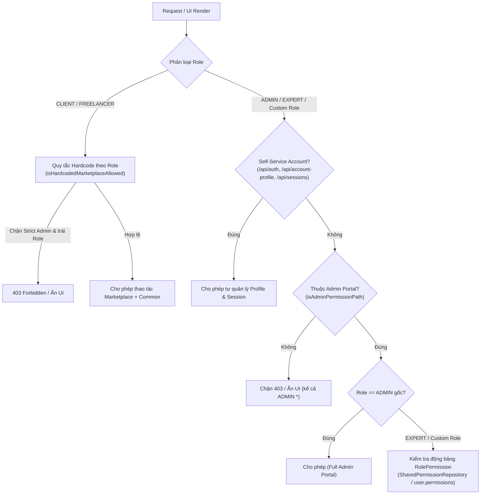

# Tài liệu kỹ thuật: Phân quyền RBAC Admin động, Ẩn/Hiện nút hành động & Bảo vệ Route Frontend

> **Nhánh Use Case**: `uc-06.08-permission-action-visibility` → cập nhật đến `uc-06.11-admin-only-dynamic-permissions`  
> **Dự án**: Frevia (frevia-clone)  
> **Phạm vi**: Monorepo (`apps/api` + `apps/web`) — Admin Portal (`/admin/*`), Public Routes & Marketplace Routes (`/client/*`, `/freelancer/*`)

---

## 1. Đặt vấn đề & Quy tắc kiến trúc

### 1.1. Tách bạch Dynamic Admin RBAC và Hardcoded Marketplace Access
Hệ thống áp dụng mô hình **Admin-Only Dynamic RBAC**:
* **Chỉ các chức năng thuộc phạm vi Admin Portal** mới có trong danh mục quyền (`Permission` table), hiển thị tại `/admin/permissions` và gán động tại `/admin/assign-role` (chủ yếu cho `EXPERT` và các **Custom Role** nội bộ như Moderator, Support...).
* **Các quyền và luồng nghiệp vụ của `CLIENT`, `FREELANCER` và Homepage/Common** được **hardcode cố định theo role** ở cả Frontend và Backend, không hiển thị hay cho phép bật/tắt động từ giao diện Admin RBAC.
* **Role `ADMIN` gốc** mặc định giữ toàn quyền trong phạm vi Admin Portal (`*`), không bị thu hồi nhầm quyền quản trị, nhưng **vẫn bị chặn** khỏi Homepage `/` và các chức năng nghiệp vụ riêng của Client/Freelancer.

### 1.2. Quy tắc truy cập Route cho `ADMIN`, `EXPERT` & Custom Role
* **Trang Homepage (`/`):** Bị chặn với `ADMIN`, `EXPERT` và mọi custom role (`isInternalAdminRole`); tự động chuyển hướng sang `/admin` (nếu `canAccessAdminPortal(user)` hợp lệ) hoặc `/access-denied`.
* **Các trang Public thật sự:** Được phép truy cập gồm `/forum` (chỉ đọc), `/profiles/[id]`, `/clients/[id]`, `/privacy-policy`, `/user-agreement`. Trên các trang này dùng `Header` chế độ `STAFF` — ẩn toàn bộ menu/nút của Client/Freelancer (tìm việc, giỏ thông báo, chat, social links...), chỉ giữ link công khai, nút vào **Admin Portal** (`/admin`), `/admin/profile`, `/admin/sessions` và **Đăng xuất**.
* **Các trang không Public ngoài `/admin`:** Toàn bộ `/client/*`, `/freelancer/*`, `/notifications`, `/conversations/*`, `/sessions`, `/account-profile` đều chặn `ADMIN`, `EXPERT` và custom role (`/access-denied` hoặc chuyển đúng về `/admin/sessions`, `/admin/profile` nếu là trang tự quản trị cá nhân).

---

## 2. Kiến trúc giải pháp (Backend & Frontend)

### 2.1. Backend (`apps/api`)
1. **`apps/api/src/shared/helper/admin-permission.ts`**:
   * `isStrictAdminEndpoint(path, method)` & `isAdminPermissionPath(path, method)`: Định nghĩa tập endpoint thuộc Admin Portal (`/api/admin/*`, `/api/expert/disputes*`, `/api/expert-profile*`, `/api/forums/admin/*`, `/api/forums/reports*`, `DELETE /api/forums/posts/:postId`, `DELETE /api/forums/posts/:postId/comments/:commentId`, `/api/users*`, `/api/roles*`, `/api/permissions*`, `POST /api/payments/disputes/:disputeId/settle`, `/reindex`, `/outbox`).
   * `ADMIN_PERMISSION_PRISMA_WHERE`: Bộ lọc Prisma dùng chung để chỉ truy vấn quyền Admin Portal.
   * `isSelfAccountOrSessionPath(path)`: Cho phép `/api/auth/*`, `/api/account-profile*`, `/api/sessions*` cho mọi tài khoản đã đăng nhập.
   * `isHardcodedMarketplaceAllowed(roleName, method, path)`: Quy tắc hardcode cho `CLIENT` và `FREELANCER`.
2. **`PermissionGuard` (`apps/api/src/shared/guards/permission.guard.ts`)**:
   * `@IsPublic()` luôn đi qua.
   * `CLIENT` / `FREELANCER`: kiểm tra theo `isHardcodedMarketplaceAllowed` (không query `RolePermission`).
   * `ADMIN` / `EXPERT` / Custom Role: cho phép `isSelfAccountOrSessionPath`, từ chối ngay nếu `!isAdminPermissionPath`, `ADMIN` gốc giữ toàn quyền Admin Portal, `EXPERT` và Custom Role query động `SharedPermissionRepository.roleHasPermission()`.
3. **API Quản trị Roles & Permissions**:
   * `PermissionsRepository` (`findAll`, `findById`, `modules`): lọc bằng `ADMIN_PERMISSION_PRISMA_WHERE`.
   * `RolesRepository.findActivePermissionIds` & `RolesRepository.findById`: chỉ làm việc với tập quyền Admin Portal.
   * `RolesService.setRolePermissions`: từ chối chỉnh sửa quyền cho `CLIENT` và `FREELANCER` (`CannotModifySystemRoleException`).
   * `AuthService.getMe`: trả `permissions: []` cho `CLIENT`/`FREELANCER`; `'*'` + Admin permissions cho `ADMIN`; chỉ trả các permission thỏa `isAdminPermissionPath` cho `EXPERT` và Custom Role.
   * `seed-permissions.ts`: chỉ seed và giữ lại các route thỏa `isAdminPermissionPath` trong bảng `Permission`; gán full cho `ADMIN`, mặc định dispute routes cho `EXPERT`, và `[]` cho `CLIENT`/`FREELANCER`.

### 2.2. Frontend (`apps/web`)
1. **Kiểm tra quyền (`apps/web/lib/admin-access.ts` & `apps/web/hooks/use-action-permission.tsx`)**:
   * `hasActionPermission(userOrPermissions, method, path)` và hook `useActionPermission()` (`can`, `canAny`, `canAll`, `<Can>`) đồng bộ 100% logic 3 nhánh với Backend:
     * `CLIENT` / `FREELANCER` dùng `isHardcodedMarketplaceAllowed`.
     * `ADMIN` / `EXPERT` / Custom Role chỉ mở `isSelfAccountOrSessionApi` + `isAdminPermissionPath`; bị khóa (`false`) đối với các hành động tương tác diễn đàn/chat/thông báo/marketplace trên trang public.
   * `canAccessAdminPortal(user)` và `isInternalAdminRole(user)`: chặn `CLIENT`/`FREELANCER` vào `/admin`, cho phép `ADMIN` hoặc role nội bộ có ít nhất 1 quyền/module Admin Portal (bao gồm `EXPERT` & `EXPERT-PROFILE`).
2. **Nhóm quyền Admin (`apps/web/lib/permission-scopes.ts` & `assign-role-content.tsx`)**:
   * Chỉ giữ duy nhất scope **`ADMIN` (Dashboard Quản trị)** với **11 Cụm chức năng (`FEATURE_GROUPS`)** và `isAssignableAdminPermission`.
   * Loại bỏ hoàn toàn các scope `CLIENT`, `FREELANCER`, `CONTRACTS`, `COMMON` ("Trang chủ & Dùng chung") khỏi giao diện `/admin/assign-role` và `/admin/permissions`; lọc bỏ `CLIENT`/`FREELANCER` khỏi dropdown chọn role trong `/admin/assign-role`.

---

## 3. Danh sách các màn hình Admin Portal áp dụng phân quyền động

### 3.1. Quản lý Kỹ năng (`ADMIN_SKILLS`)
* **Route**: `/admin/skills` & `/admin/skills/[id]`
* **Các quyền**: `GET /api/admin/skills`, `GET /api/admin/skills/:id`, `POST /api/admin/skills`, `PATCH /api/admin/skills/:id`, `DELETE /api/admin/skills/:id`, `PATCH /api/admin/skills/:id/restore`.

### 3.2. Quản lý Danh mục Công việc (`ADMIN_JOB_CATEGORIES`)
* **Route**: `/admin/job-categories` & `/admin/job-categories/[id]`
* **Các quyền**: `GET /api/admin/job-categories`, `GET /api/admin/job-categories/:id`, `POST /api/admin/job-categories`, `PATCH /api/admin/job-categories/:id`, `DELETE /api/admin/job-categories/:id`, `PATCH /api/admin/job-categories/:id/restore`.

### 3.3. Quản lý Banner & Quảng cáo (`ADMIN_BANNERS`)
* **Route**: `/admin/banners` & `/admin/banners/[id]`
* **Các quyền**: `GET /api/admin/banners`, `GET /api/admin/banners/:id`, `POST /api/admin/banners`, `PATCH /api/admin/banners/:id`, `DELETE /api/admin/banners/:id`, `POST /api/admin/banners/upload-image`.

### 3.4. Phán quyết Tranh chấp (`ADMIN_DISPUTES`)
* **Route**: `/admin/disputes` ([expert-disputes.tsx](file:///e:/PROJECT/Frevia/apps/web/app/admin/disputes/expert-disputes.tsx))
* **Các quyền**:
  * `GET /api/expert-profile/me` & `PUT /api/expert-profile/me`
  * `GET /api/expert/disputes` & `GET /api/expert/disputes/:id`
  * `POST /api/expert/disputes/:id/decision` & `POST /api/expert/disputes/:id/final-decision`
  * `POST /api/payments/disputes/:disputeId/settle`
  *(Ghi chú: Cổng cũ `/expert/*` ở frontend đã được xóa ở `uc-06.10` và gộp hoàn toàn về `/admin/disputes` + `/admin/profile`.)*

### 3.5. Duyệt Xác minh Danh tính eKYC (`ADMIN_KYC`) & Duyệt Hồ sơ (`ADMIN_PROFILE_REVISIONS`)
* **Route**: `/admin/identity-verifications` & `/admin/profile-revisions`
* **Các quyền**: `/api/admin/identity-verifications*` (`GET`, `approve`, `reject`) và `/api/admin/profile-revisions*` (`GET`, `approve`, `reject`).

### 3.6. Kiểm duyệt Diễn đàn (`ADMIN_FORUMS`)
* **Route**: `/admin`, `/admin/categories`, `/admin/categories/[id]`, `/admin/comments`, `/admin/moderation`, `/admin/reports`, `/admin/posts`, `/admin/trash`
* **Các quyền**:
  * `/api/forums/admin/stats`, `/api/forums/admin/comments`, `/api/forums/admin/pending-posts`
  * `/api/forums/admin/posts/:id/approve`, `/api/forums/admin/posts/:id/reject`
  * `/api/forums/admin/categories*`, `/api/forums/admin/trash/posts*`, `/api/forums/admin/trash/comments*`
  * `GET /api/forums/reports`, `PATCH /api/forums/reports/:reportId/status`
  * `DELETE /api/forums/posts/:postId`, `DELETE /api/forums/posts/:postId/comments/:commentId`

### 3.7. Quản lý Người dùng, Vai trò, Quyền & Vận hành AI
* `ADMIN_USERS`: `/admin/users`, `/admin/users/[id]` (`/api/users*`)
* `ADMIN_ROLES`: `/admin/roles`, `/admin/roles/[id]`, `/admin/assign-role` (`/api/roles*`)
* `ADMIN_PERMISSIONS`: `/admin/permissions`, `/admin/permissions/[id]` (`/api/permissions*`)
* `ADMIN_AI_OPS`: `/admin/ai-ops` (`/api/recommendations/reindex`, `/api/recommendations/outbox/process`)

---

## 4. Tổng hợp các tệp thay đổi trọng tâm (`uc-06.11`)

| Đường dẫn tệp | Loại | Mô tả |
| :--- | :--- | :--- |
| `apps/api/src/shared/helper/admin-permission.ts` | Tạo mới | Định nghĩa `ADMIN_PERMISSION_PRISMA_WHERE`, `isStrictAdminEndpoint`, `isAdminPermissionPath`, `isSelfAccountOrSessionPath`, `isHardcodedMarketplaceAllowed`. |
| `apps/api/src/shared/guards/permission.guard.ts` | Chỉnh sửa | Tách luồng hardcode cho Client/Freelancer và dynamic DB RBAC chỉ trong phạm vi Admin Portal cho Admin/Expert/Custom Role. |
| `apps/api/src/routes/permissions/permissions.repo.ts` | Chỉnh sửa | Lọc danh sách/module/chi tiết quyền chỉ trả về Admin Portal permissions. |
| `apps/api/src/routes/roles/roles.repo.ts` & `roles.service.ts` | Chỉnh sửa | Chỉ cho phép xem và gán Admin Portal permissions; chặn sửa quyền `CLIENT`/`FREELANCER`. |
| `apps/api/src/routes/auth/auth.service.ts` | Chỉnh sửa | Chuẩn hóa `permissions`/`permissionModules` trả về từ `getMe()` theo từng nhóm role. |
| `apps/api/src/seed-datas/seed-permissions.ts` | Chỉnh sửa | Chỉ seed Admin Portal permissions vào DB; `ADMIN` nhận full, `EXPERT` nhận bộ disputes mặc định, `CLIENT`/`FREELANCER` nhận `[]`. |
| `apps/web/lib/admin-access.ts` & `hooks/use-action-permission.tsx` | Chỉnh sửa | Đồng bộ logic 3 nhánh và `canAccessAdminPortal()` cho `EXPERT`/Custom Role. |
| `apps/web/lib/permission-scopes.ts` & `assign-role-content.tsx` | Chỉnh sửa | Xóa scope Homepage/Client/Freelancer/Common; chỉ giữ scope `ADMIN` (11 nhóm) và các role gán động. |
| `apps/web/components/header.tsx`, `app/page.tsx`, `app/forum/layout.tsx`, `app/profiles/[id]/*`, `app/clients/[id]/*`, `app/notifications/page.tsx`, `app/conversations/layout.tsx`, `app/sessions/page.tsx`, `app/account-profile/page.tsx`, `app/dashboard/page.tsx`, `app/not-found.tsx`, `app/access-denied/access-denied-content.tsx` | Chỉnh sửa | Chặn `ADMIN`/Custom Role vào `/` và các trang non-public ngoài `/admin`; thêm chế độ Header `STAFF` cho các trang public. |

---

## 5. Kết quả kiểm tra xác nhận (Verification)

* **TypeScript (`apps/web`)**: `pnpm --filter web check-types` (`next typegen && tsc --noEmit`) pass 0 lỗi.
* **NestJS Build (`apps/api`)**: `pnpm --filter api build` biên dịch thành công.
* **Unit Tests (`apps/api`)**:
  * `src/shared/guards/permission.guard.spec.ts`: 9/9 test cases pass.
  * `test/auth/auth.unit-spec.ts`, `test/permissions/permissions.unit-spec.ts`, `test/roles/roles.unit-spec.ts`: 3 suites (96/96 test cases) pass.
